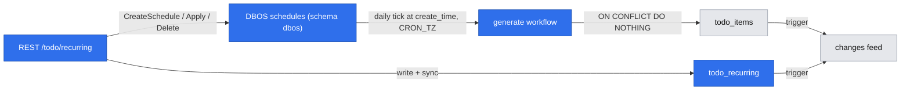
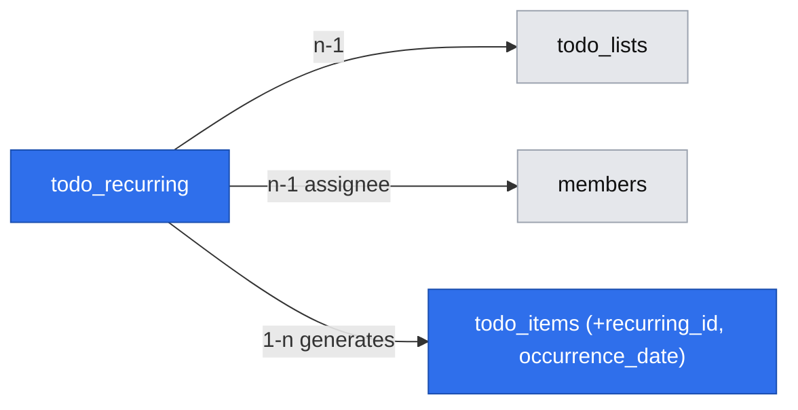

# Recurring tasks

## 📝 TLDR

Households with chores and obligations that repeat on a calendar ("close the company books" monthly; "do groceries" every Monday and Friday, due two days later) must create every instance by hand today. This spec proposes **recurring task templates** in the todo module: a template carries an RFC 5545 RRULE, a creation time of day and a relative due date, and the server creates a normal task on each occurrence. Scheduling runs on DBOS (`dbos-transact-golang`) with one database-backed schedule per template. Future behavior; nothing here exists yet.

Source: issue #27; handoff brief `.ai/specs/briefs/2026-11-23-recurring-tasks.md`.

## Resolved assumptions (autonomous defaults)

The brief's Resolved-unknowns table pre-answered the schedule model, mode (fixed calendar only), relative due, DBOS and UI entry point. The questions it left open were defaulted as below. None is marked `⚠ NEEDS HUMAN CONFIRMATION`: each is reversible and touches no protected surface beyond the additive schema and endpoints described here.

| # | Question | Chosen default | Rationale |
|---|---|---|---|
| Q1 | Split into several specs? | No: one capability (templates + generation), delivered in two phases | Server alone is useless to users, but phases ship independently |
| Q2 | Time of day when the task is created | Per template, `create_time`, default 06:00 household local time | Matches the "appears in the morning" use case; needs no extra setting |
| Q3 | Who may create/edit/delete templates | Any household member, like tasks | Same model as `todo_items` |
| Q4 | What happens to generated tasks when a template is deleted or paused | They stay (`recurring_id` becomes NULL on delete); pausing only stops future ones | Never destroy user data implicitly |
| Q5 | Relative due date shapes | Offset in whole days from the occurrence date (0 = same day, null = no due date), plus optional `due_time` | Covers the brief's examples; "next weekday" deferred |
| Q6 | Series end | Optional `end_date` (inclusive); no occurrence count | RRULE `COUNT`/`UNTIL` are rejected so the end is one explicit, editable field |
| Q7 | Where DBOS keeps its state | The application's Postgres, default schema `dbos`, managed by DBOS itself | No new infrastructure; goose does not manage that schema |
| Q8 | Catch-up after downtime | Create only the latest missed occurrence | From the brief |
| Q9 | Preview of next occurrences | Computed by the server (`POST /todo/recurring/preview`), not in Dart | One RRULE implementation, the Go one already in the repo |
| Q10 | Mock mode of the app | `MockTodoRepository` stores templates but never generates tasks | Server owns generation; the mock only needs the UI to work |

## 📝 Problem Statement

Repeating obligations are the core of household task management. Without recurrence the user re-enters the same task on a calendar, or forgets it. The owner's examples need a calendar model richer than "every N days": weekday sets (Mon+Fri), month-based rules ("every month", last day of the month) and a due date relative to creation.

## 📝 Proposed Solution

- **Template** = a row in a new table `todo_recurring`, scoped by `household_id`, pointing at a target list and carrying the task fields to copy, the RRULE, `start_date`, optional `end_date`, `create_time`, and the relative due.
- **Schedule** = RFC 5545 RRULE restricted to `DAILY`, `WEEKLY`, `MONTHLY`, `YEARLY` (with `INTERVAL`, `BYDAY`, `BYMONTHDAY`, `BYSETPOS`, `BYMONTH`). DTSTART is derived from `start_date` + `create_time`; it is not stored inside the RRULE string.
- **Generation**: one DBOS schedule per active template fires daily at `create_time` in the household timezone. The workflow checks whether that local date matches the RRULE and, if so, inserts the task idempotently.
- **Edit UI**: a button next to the edit icon in the list view opens a drawer with presets (daily, weekly on chosen days, monthly on a day or the last day, yearly, custom every-N), the relative due, and a live preview of the next occurrences.

Alternatives considered and rejected:

| Alternative | Why it lost |
|---|---|
| Cron expression as the user model | Cannot express "every 2 weeks", "last day of month", "first Monday" |
| Structured JSON schedule with own date maths | New date logic to maintain; RRULE already ships in `rrule-go` and the calendar module |
| Single global once-a-minute tick over `next_run_at` | Works, and is the **fallback** if DBOS dynamic schedules prove unusable; DBOS gives exactly-once ticks, downtime handling and multi-instance safety for free |
| "Repeat after completion" | Explicitly not wanted by the owner |
| Build nothing | The problem is real and has no cheaper workaround |

## 📝 Delta

### Capability: recurring-tasks

#### ADDED Requirement: Recurring task template
The system SHALL let a household member define a template that names a target list, task fields, an RRULE schedule, a creation time, and an optional relative due date.

##### Scenario: Create a weekly template
- WHEN a member creates a template with `FREQ=WEEKLY;BYDAY=MO,FR` and due offset 2
- THEN the template is stored, shown in the list view's recurring drawer, and its next occurrences are previewed

#### ADDED Requirement: Scheduled task creation
The system SHALL create exactly one task per matching local date for each active template, at the template's creation time in the household timezone.

##### Scenario: Occurrence day
- WHEN the local date matches the template's RRULE and the creation time is reached
- THEN a task with the template's title, description and assignee appears in the target list, with due = occurrence date + offset (and the template's due time)

##### Scenario: Non-matching day
- WHEN the local date does not match the RRULE, or is outside `start_date`..`end_date`, or the template is paused
- THEN no task is created

##### Scenario: Duplicate trigger
- WHEN the same occurrence is triggered twice (restart, two instances)
- THEN still only one task exists for that occurrence

#### ADDED Requirement: Catch-up after downtime
The system SHALL, after the server was down through one or more occurrences, create only the latest missed occurrence when it comes back.

##### Scenario: Missed Monday and Friday
- WHEN the server was down over a Monday and a Friday occurrence and restarts on Saturday
- THEN one task (for Friday) is created

#### ADDED Requirement: Pausing and deleting
The system SHALL stop creating tasks when a template is paused or deleted, and SHALL keep tasks it already created.

##### Scenario: Delete template
- WHEN a member deletes a template
- THEN no further tasks are created and previously created tasks remain

Frozen by: none — all requirements are ADDED.

## 📝 Architecture

Primary module: `server/internal/modules/todo` (templates, REST, view) plus a new small package `server/internal/recurring` for the DBOS engine and schedule sync. Existing components reused: `core.Write` (mutation + change feed), `oiko_track` triggers, `rrule-go` (already an indirect dependency via the calendar module, to become direct), `core.Date` / `core.TimeOfDay`, `Household.Timezone`.



Takeaway: DBOS only decides *when* to wake up; the template table remains the source of truth and the RRULE decides *whether* an occurrence exists.

### DBOS integration

- Dependency `github.com/dbos-inc/dbos-transact-golang` (requires Go 1.26, the repo is on 1.26.8). Initialized in `main.go` next to the app with `AppName: "oikoboard"`, the existing `OIKO_DATABASE_URL`, default schema `dbos`; `Launch` before serving, `Shutdown` on exit. Failing to start DBOS stops the server with a clear error (no silent degradation: tasks would silently stop appearing).
- One workflow `generateRecurringTask(ctx, ScheduledWorkflowInput)` registered once. API surface verified against upstream (`v1.9.0`): `CreateSchedule` after `Launch` with `ScheduleSpec{ScheduleName, Schedule, Workflow, Context, CronTimezone, AutomaticBackfill}`, plus `ApplySchedules`, `PauseSchedule`, `ResumeSchedule`, `DeleteSchedule`, `ListSchedules`; schedules are database-backed and each process re-reads them periodically (`SchedulerPollingInterval`, default 30 s; set to 5 s here), so an edit or delete reaches the other instances (and this one's cron entries) within that interval. The spike showed a stale tick can still fire briefly after `DeleteSchedule`, which is harmless: `generate` re-reads the template and no-ops when it is paused or gone. `ApplySchedules` upserts but never deletes, so orphans are removed through `ListSchedules` + `DeleteSchedule`.
- Schedule name `recurring-{template_id}`; 6-field cron (DBOS uses seconds) `"0 {minute} {hour} * * *"` with `CronTimezone` = household timezone; `Context` = `{template_id}`; `AutomaticBackfill: false` (catch-up is ours, see below, because DBOS backfill would replay every missed daily tick).
- **Boot reconcile**: after `Launch`, load all active templates, `ApplySchedules` for them, delete `recurring-*` schedules without a template (orphans, e.g. after a list delete cascaded), then run the catch-up pass.
- **One generation function** `generate(templateID, occurrenceDate)` holds all the logic: load template (missing or paused → no-op); skip outside `start_date`..`end_date`; match = RRULE (DTSTART = `start_date` + `create_time` in tz) has an occurrence on that date; if matched, insert the item through `core.Write` (so the `changes` feed fires) with `ON CONFLICT DO NOTHING`; always set `last_run_date = occurrenceDate` (also when nothing matched, so the catch-up window never grows stale). It takes the date as an argument, so it is testable without DBOS or a clock.
- **Workflow body** = derive the local date from `ScheduledTime` with the timezone helper below, then call `generate` inside a DBOS step (durable, retried).
- **Catch-up pass** (boot only): for each active template find the latest RRULE occurrence date in `(last_run_date, today]` (today only when `create_time` has passed; the clock is injectable) and call `generate` for it. Older missed occurrences are skipped by design; `last_run_date` is then advanced to today.
- **`last_run_date` rules**: advanced by every processed tick or catch-up; reset to "today if `create_time` has passed, else yesterday" only when `rrule`, `start_date` or `create_time` changes (a new schedule never generates retroactive tasks, while edits to title/due/assignee never skip a pending occurrence).
- **Timezone helper**: a single function `localDate(instant, tz)` (invalid tz → UTC with a log) is the only place dates are derived, used by the workflow, catch-up and the preview endpoint.
- **Household timezone change**: re-sync the schedules of that household (they carry the timezone). Existing `last_run_date` values stay valid because they are dates. Today the timezone is only set when a household is created, so only the boot `Reconcile` exists; an endpoint that changes it must call `Reconcile`.
- **Scheduler interface**: handlers talk to a small `Scheduler` interface (`Sync(template)`, `Remove(id)`, `Reconcile()`); `DBOSScheduler` implements it. Fallback decision: if the DBOS spike (Phase 1, Step 1) shows the dependency or its schema is unworkable, a `TickScheduler` (once a minute, templates selected by `FOR UPDATE SKIP LOCKED` on a computed `next_run_date`) implements the same interface; table, API and `generate` stay identical, and `next_run_date` would be added by that fallback's migration only.

## 📝 Data Model

Migration `00017_todo_recurring.sql` (new numbered goose migration, with Down):

```
todo_recurring
  id uuid PK, household_id uuid NOT NULL -> households ON DELETE CASCADE
  list_id uuid NOT NULL, FK (household_id, list_id) -> todo_lists ON DELETE CASCADE
  title text NOT NULL, description text NOT NULL DEFAULT ''
  assignee_id uuid NULL, FK (household_id, assignee_id) -> members ON DELETE SET NULL (assignee_id)
  rrule text NOT NULL            -- no DTSTART, no COUNT/UNTIL
  start_date date NOT NULL, end_date date NULL
  create_time time NOT NULL DEFAULT '06:00'
  due_offset_days int NULL CHECK (due_offset_days BETWEEN 0 AND 366)   -- NULL = no due date
  due_time time NULL CHECK (due_time IS NULL OR due_offset_days IS NOT NULL)
  active boolean NOT NULL DEFAULT true
  last_run_date date NULL
  created_at, updated_at, version  (as the other todo tables)
  UNIQUE (household_id, id); SELECT oiko_track('todo_recurring');

todo_items  ADD recurring_id uuid NULL, occurrence_date date NULL
  FK (household_id, recurring_id) -> todo_recurring ON DELETE SET NULL (recurring_id)
  UNIQUE INDEX (recurring_id, occurrence_date) WHERE recurring_id IS NOT NULL
```

The unique index is the idempotency key for live templates. After a template is deleted its tasks have `recurring_id` NULL and leave the index, which is intended (they become ordinary tasks). `recurring_id` also lets the UI show a "repeats" marker on generated tasks (optional, Phase 2).



## 📝 API Contracts

All under the protected group, scoped by the caller's household. Same conventions as the other todo endpoints (client-generated `id`, idempotent create via mutation id, PATCH with explicit nulls).

- `POST /todo/recurring` — `{id?, list_id, title, description?, assignee_id?, rrule, start_date, end_date?, create_time?, due_offset_days?, due_time?, active?}` → the row.
- `PATCH /todo/recurring/:id` — any subset of the same fields.
- `DELETE /todo/recurring/:id`.
- `POST /todo/recurring/preview` — `{rrule, start_date, end_date?, count (≤ 20)}` → `{dates: ["YYYY-MM-DD", …]}`, computed in the household timezone.
- View `todo.recurring` (entity `todo_recurring`) over the realtime feed, a new `core.View` registered in the todo module: all templates of the household.

Validation (400 on failure): RRULE parses with `rrule-go`; `FREQ` ∈ DAILY/WEEKLY/MONTHLY/YEARLY; `COUNT`, `UNTIL`, `DTSTART` and sub-daily frequencies rejected; `end_date >= start_date`; list and assignee belong to the household; at most 100 templates per household. Compatibility: purely additive; no existing endpoint, field or message changes shape. Old clients ignore the new view and the two extra item fields.

## 📝 UI/UX

- List view: a "repeat" icon button beside the existing edit icon opens a drawer listing the list's templates with an add button; each row shows title, a human summary of the rule, next occurrence, and a pause switch.
- Template form: title, description, assignee, **Repeat** presets (daily · weekly with weekday chips · monthly: day of month or last day · yearly · custom: every N days/weeks/months with the same options), **Start** date, optional **End** date, **Creates at** time, **Due**: none / same day / N days after creation (+ optional time). Beneath the form the next 5 occurrences (from the preview endpoint, debounced) and the resulting due date of the first one.
- States: empty list of templates (explanatory empty state), loading, validation error from the server, offline (form disabled with the usual offline notice).
- Presets generate the RRULE string in Dart; the summary text is built from l10n ICU strings, never by concatenating translated fragments.
- Accessibility: weekday chips are toggle buttons with labels; the drawer is dismissible and focus-trapped like the existing ones.

## 📝 Edge Cases & Failure Scenarios

- **Create/change a schedule mid-day**: `last_run_date` is set to today when `create_time` has passed, otherwise yesterday, so a new template never generates retroactive tasks.
- **Server down at the tick**: catch-up creates the latest missed occurrence at next boot; earlier misses are skipped by design.
- **DBOS database unreachable at runtime**: ticks are delayed, then run when the connection returns; the unique index prevents duplicates.
- **Two instances**: DBOS runs each tick once; if both did, `ON CONFLICT DO NOTHING` absorbs it.
- **DST**: a `create_time` inside the skipped spring-forward hour may fire at the shifted time or be caught up at next boot; the UI default (06:00) avoids it.
- **Impossible dates** (`BYMONTHDAY=31`): months without that day simply have no occurrence; the preview shows this.
- **Invalid household timezone**: fall back to UTC and log; never crash the scheduler.
- **List deleted**: templates cascade; orphan DBOS schedules are removed at boot and the workflow no-ops when the template is gone.
- **Template edited while a tick runs**: the workflow reads the template inside its own step; either old or new values apply, never a mix.

## 📝 Risks & Impact Review

- **New infrastructure dependency (DBOS)**: adds a module, a `dbos` schema in the existing Postgres and its own migrations; removal means dropping that schema. Mitigation: the template table is the source of truth and the fallback ticker needs no DBOS.
- **Hard to reverse**: the table and two item columns (additive; Down drops them), and the public endpoints once clients use them.
- **Timezone semantic**: schedules follow the household timezone at the time of the tick; changing the timezone shifts later occurrences by design.
- Product call, not a rule violation: a per-household cap of 100 templates and restricting RRULE features.

## 📋 Phasing

1. **Phase 1 — Server**: migration, templates REST + view, DBOS engine, generation, catch-up. Independently shippable (templates can be created through the API / MCP-style clients).
2. **Phase 2 — App**: models, repository (Mock + Api), drawer UI, l10n, preview.

## 📋 Implementation Plan

### Phase 1: Server

1. **Spike DBOS schedules.** Add the dependency and a `Scheduler` interface. In an integration test gated by the build tag `dbos` (so the default `go test` stays fast and deterministic), start DBOS against the compose Postgres, `CreateSchedule` after `Launch` with `CronTimezone` and a per-second cron, verify it fires, then `DeleteSchedule` stops it; record whether `ApplySchedules` removes unlisted schedules. **Pass** = fires, stops, survives a restart of the context. **Fail** → implement `TickScheduler` instead and drop the dependency before merging anything else. The step commits only the interface and the test; nothing else depends on DBOS until it passes.
2. **Migration `00017`** (table, item columns, unique index, `oiko_track`) with Down; a migration test up/down.
3. **Model + validation** in the todo module: `Recurring` struct, RRULE validation, per-household cap. Unit tests for validation and for "does the date match the rule" (weekly Mon+Fri, monthly, last day of month, DST day, end date).
4. **`generate` and the timezone helper** in the recurring package: idempotent insert through `core.Write` (new items go to the top of the list, `OnItemsChanged` called), `last_run_date` rules. Tests without DBOS: Monday+Friday, monthly, last day, DST day, end date, paused, duplicate call → one task.
5. **REST handlers + view + preview** (`POST/PATCH/DELETE /todo/recurring`, `preview`, view `todo_recurring`) calling the `Scheduler` interface (a no-op implementation in tests), with household-scoped tests in `server/internal/app` (another household cannot read or touch it).
6. **`DBOSScheduler` wiring** in `main.go`/`app`: workflow registration, `Sync`/`Remove`, boot `Reconcile` (apply, delete orphans) and the catch-up pass, household timezone change hook. Tests with an injectable clock: missed Monday+Friday → one task; schedule edit resets `last_run_date` only for schedule fields.
7. **Docs**: one short section in `docs/architecture.md` on recurring tasks and DBOS (design decision and the schema it owns), the `OIKO_*` variables if any are added.

### Phase 2: App

1. Models and `RecurringRepository` interface with `MockRecurringRepository` and `ApiRecurringRepository`; realtime subscription to the `todo_recurring` view. Tests.
2. RRULE builder/summary helper from the form state (presets and custom) in Dart, with unit tests.
3. Drawer and form UI, preview call, validation errors; l10n keys in `app_en.arb` and `app_pl.arb`.
4. Button in the list view next to the edit icon; widget tests for the drawer flow with the mock repository.
5. **Archive the Delta** into `.ai/specs/capabilities/recurring-tasks.md` on the implementation PR.
