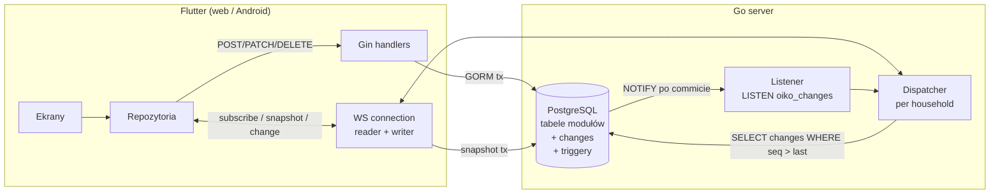
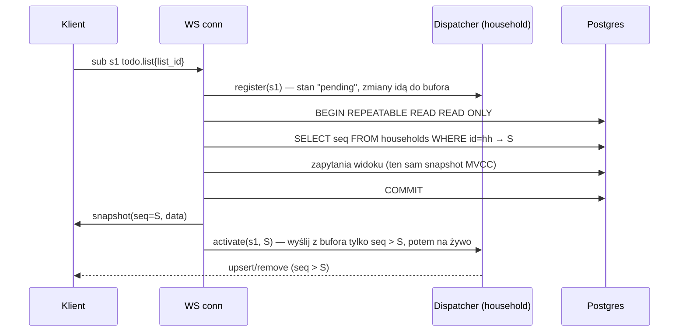

# Backend i synchronizacja realtime — projekt

Status: **zaimplementowane** (MVP) — `server/`, testy w `server/internal/app/app_test.go`. Ten dokument opisuje, jak zbudować backend
(Go + Gin + GORM + PostgreSQL), żeby aplikacja na bieżąco dostawała zmiany,
ale tylko te, które dotyczą otwartych w niej widoków.

---

## TL;DR

1. **Zapisy idą REST-em** (Gin). Odczyty idą przez **WebSocket**.
2. Każda zmiana w tabeli modułu jest zapisywana przez **trigger w Postgresie** do tabeli `changes`,
   **w tej samej transakcji**. Trigger nadaje numer `seq` (rośnie osobno w każdym gospodarstwie) i robi `pg_notify`.
   Postgres wysyła NOTIFY dopiero po commicie, więc rollback niczego nie rozgłasza.
3. Serwer ma **jedno połączenie LISTEN** do bazy. Po powiadomieniu doczytuje
   nowe wiersze z `changes` i rozdaje je **subskrypcjom widoków** otwartych w aplikacjach.
4. Aplikacja ma **jeden WebSocket**, po którym przesyła wiele subskrypcji naraz. Ekran mówi
   `subscribe {view: "todo.list", params: {list_id}}`. **Pierwsza odpowiedź to snapshot stanu
   z numerem `seq`**, a potem przychodzą tylko zmiany o wyższym `seq`, które pasują do tego widoku.
   Snapshot i strumień idą tym samym kanałem, więc nie ma wyścigu.
5. **Reconnect = ponowny subscribe = świeży snapshot.** Dane rodzinne są małe, więc to tanie
   i zawsze poprawne. Wznawianie od `since: seq` to późniejsza optymalizacja (protokół jest na nią gotowy).

---

## Architektura



### Dlaczego zapisy przez REST, a nie przez WebSocket
- Zwykłe kody błędów (400/403/404/409), walidacja, łatwe testowanie curl-em.
- Zapis nie zależy od stanu połączenia WS.
- Własna zmiana i tak wraca przez WS (patrz [Optymistyczne UI](#własne-zapisy-i-optymistyczne-ui)).

---

## Baza danych

### Tabele modułów
Zwykłe tabele z typowanymi kolumnami. Każda ma `household_id` (zdenormalizowane, np. `todo_items` też ma `household_id`,
choć mogłoby wynikać z listy). Dzięki temu trigger jest generyczny.

```
households        (id uuid pk, name, seq bigint not null default 0)
members           (id uuid pk, household_id, name, color, ...)
todo_lists        (id uuid pk, household_id, name, description, color, due date, created_at, updated_at, version)
todo_items        (id uuid pk, household_id, list_id fk on delete cascade, title, description, done, done_at,
                   assignee_id, due date, created_at, updated_at, version)
todo_comments     (id uuid pk, household_id, item_id fk on delete cascade, author_id, body, created_at, ...)
calendar_events   (id uuid pk, household_id, title, starts_at, ends_at, all_day,
                   member_ids uuid[], created_at, updated_at, version)
```

Identyfikatory to **UUID generowane przez klienta**. Dzięki temu `POST` jest idempotentny
(retry nie duplikuje) i klient zna id od razu, co ułatwia optymistyczne UI i późniejszy offline.

### Dziennik zmian (`changes`)
```sql
CREATE TABLE changes (
  household_id uuid        NOT NULL,
  seq          bigint      NOT NULL,
  entity       text        NOT NULL,      -- nazwa tabeli: 'todo_items'
  entity_id    uuid        NOT NULL,
  op           text        NOT NULL,      -- 'insert' | 'update' | 'delete'
  before       jsonb,                      -- NULL przy insert
  after        jsonb,                      -- NULL przy delete
  actor_id     uuid,                       -- kto (z SET LOCAL)
  mutation_id  uuid,                       -- id operacji od klienta (z SET LOCAL)
  created_at   timestamptz NOT NULL DEFAULT now(),
  PRIMARY KEY (household_id, seq)
);
```

### Generyczny trigger
Moduł w swojej migracji robi tylko `SELECT oiko_track('todo_items');`.

```sql
CREATE FUNCTION oiko_capture() RETURNS trigger AS $$
DECLARE
  hh  uuid := COALESCE(NEW.household_id, OLD.household_id);
  s   bigint;
BEGIN
  -- Blokuje wiersz gospodarstwa do końca transakcji => seq w obrębie
  -- gospodarstwa jest nadawany i commitowany w tej samej kolejności.
  UPDATE households SET seq = seq + 1 WHERE id = hh RETURNING seq INTO s;

  INSERT INTO changes (household_id, seq, entity, entity_id, op, before, after, actor_id, mutation_id)
  VALUES (hh, s, TG_TABLE_NAME, COALESCE(NEW.id, OLD.id), lower(TG_OP),
          CASE WHEN TG_OP <> 'INSERT' THEN to_jsonb(OLD) END,
          CASE WHEN TG_OP <> 'DELETE' THEN to_jsonb(NEW) END,
          nullif(current_setting('oiko.actor', true), '')::uuid,
          nullif(current_setting('oiko.mutation', true), '')::uuid);

  -- Payload tylko "household:seq" (limit NOTIFY to 8000 B). Treść czytamy z tabeli.
  PERFORM pg_notify('oiko_changes', hh || ':' || s);
  RETURN NULL;
END $$ LANGUAGE plpgsql;
```

Dlaczego trigger, a nie hook w GORM:
- **nie da się zapomnieć**: każdy zapis, łącznie z `ON DELETE CASCADE` i ręcznym SQL-em w psql, trafia do `changes`;
- zmiana danych, wpis w `changes` i NOTIFY są w **jednej transakcji**, więc to jest atomowe;
- `before`/`after` są pełne i spójne.

Kto i jaką operacją: handler Gina na początku transakcji wywołuje
`SET LOCAL oiko.actor = '<member>'; SET LOCAL oiko.mutation = '<X-Mutation-Id>'`.

#### Dlaczego licznik w `households`, a nie `bigserial`
Przy `bigserial` transakcja A może dostać `seq=10`, a B `seq=11`, i B może skommitować się pierwsza.
Listener widzi 11, przesuwa kursor, a 10 pojawia się później i **ginie**. Licznik w wierszu
gospodarstwa pod blokadą wierszową szereguje zapisy w obrębie jednej rodziny (dla rodziny to żaden koszt).
Dzięki temu w gospodarstwie zachodzi **kolejność seq = kolejność commitów**, bez dziur.

### Retencja
`changes` czyścimy z wpisów starszych niż ~30 dni (cron w serwerze). Tabela służy do:
doganiania po zerwaniu LISTEN, przyszłego wznawiania `since`, a także jako historia i debug.

---

## Widoki (views) — „co kogo interesuje”

Widok to **nazwany zbiór encji z parametrami**: dokładnie to, co pokazuje jeden ekran albo kafelek.
Subskrypcja = `(view, params)`. Serwer wysyła do subskrypcji tylko zmiany encji, które **należą
albo należały** do tego zbioru.

| Widok             | Parametry       | Zawiera                                             | Kto używa |
|-------------------|-----------------|-----------------------------------------------------|-----------|
| `todo.lists`      | —               | wszystkie `todo_lists` gospodarstwa                 | panel/chipy list |
| `todo.list`       | `list_id`       | ta lista + wszystkie jej `todo_items`               | ekran listy |
| `todo.open`       | —               | niezrobione `todo_items` gospodarstwa               | ściana, liczniki przy listach |
| `todo.comments`   | `item_id`       | `todo_comments` of one task (its thread)            | task editor |
| `calendar.range`  | `from`, `to`    | `calendar_events` nachodzące na przedział           | miesiąc w kalendarzu, ściana |

Liczby („4 do zrobienia”) liczy klient z encji, a nie serwer. Dzięki temu widoki to zwykłe filtry,
a nie agregaty, które trzeba przeliczać.

### Klasyfikacja zmiany
Dla każdej zmiany i każdej subskrypcji w gospodarstwie:

```
was := before != nil && view.Matches(params, before)
is  := after  != nil && view.Matches(params, after)

is            → wyślij  upsert(entity)
was && !is    → wyślij  remove(entity)    // np. zadanie odhaczone znika z todo.open,
                                           // wydarzenie przesunięte poza widoczny miesiąc
!was && !is   → nic
```

Klient nie musi znać logiki filtrów, bo dostaje gotowe „dodaj/zaktualizuj” albo „usuń z widoku”.
Przykład z pytania: ekran listy zakupów subskrybuje `todo.list{list_id: zakupy}`.
Zmiana tytułu wydarzenia w kalendarzu nie pasuje (`entity` inne), więc **nie jest wysyłana**.

### Kontrakt w Go
```go
type View interface {
    Name() string                                          // "todo.list"
    ParseParams(raw json.RawMessage) (any, error)          // walidacja parametrów
    Snapshot(ctx context.Context, tx *gorm.DB,             // stan początkowy
             hh uuid.UUID, params any) (Entities, error)   // map[entity][]row
    Matches(params any, ch Change, row json.RawMessage) bool // czy wiersz należy do widoku
}

type Module interface {
    Name() string
    Routes(r *gin.RouterGroup, d Deps)   // REST zapisów
    Views() []View
}
```
Nowy moduł (np. waga) to tabela + `oiko_track('weight_entries')` + handlery + 1–2 widoki.
Rdzeń (listener, dispatcher, WS) się nie zmienia.

---

## Protokół WebSocket

`GET /api/v1/ws`: jedno połączenie na aplikację, wiele subskrypcji (multiplex), JSON.

**Klient → serwer**
```jsonc
{"t":"auth","token":"..."}                                    // pierwsza wiadomość (zły token → close 4001)
{"t":"sub","id":"s1","view":"todo.list","params":{"list_id":"…"}}
{"t":"sub","id":"s2","view":"todo.open","params":{},"since":1180} // (przyszłość) wznowienie
{"t":"unsub","id":"s1"}
```

**Serwer → klient**
```jsonc
{"t":"snapshot","sub":"s1","seq":1203,
 "data":{"todo_lists":[{…}],"todo_items":[{…},{…}]}}
{"t":"ready","member_id":"…","household_id":"…"}  // po udanym auth
{"t":"upsert","sub":"s1","op":"insert","seq":1204,"entity":"todo_items","id":"…",
 "row":{…},"actor":"…","mutation":"…"}
{"t":"remove","sub":"s1","op":"update","seq":1207,"entity":"todo_items","id":"…",
 "row":{…}}   // row = ostatni stan; op=update → wypadło z widoku, op=delete → usunięte
{"t":"error","sub":"s1","code":"bad_params","msg":"…"}
{"t":"ping"}                                       // heartbeat every 5 s
```
Every 5 s the server sends an app-level `{"t":"ping"}`, because browsers don't expose control frames,
and, separately, a WebSocket ping (no pong within 15 s → it closes the connection). Once a connection
has delivered a heartbeat, the client treats ~12 s without any message (and any connection 10 s
without `ready`) as a dead, possibly half-open socket and reconnects; a server that sends no
heartbeats is judged only by the socket closing. Reconnects use a backoff capped at 3 s and happen
immediately when the app returns to the foreground. The UI reports "offline" only after 3 s without
a connection, so a quick reconnect doesn't flicker.

### Snapshot + strumień bez wyścigu



Dlaczego to jest poprawne:
- `households.seq` zmienia się **w tej samej transakcji** co dane (trigger). Snapshot w jednej
  transakcji REPEATABLE READ widzi więc dokładnie dane wszystkich zmian `≤ S` i żadnej `> S`.
- Subskrypcja jest zarejestrowana **przed** rozpoczęciem snapshotu. Każda zmiana, której snapshot
  nie widział (`> S`), skommituje się po rejestracji, więc trafi do bufora.
- Zmiany `≤ S`, które dotrą do bufora, są odrzucane, bo są już w snapshocie.

---

## Goroutines na serwerze

```
main
 ├── Gin HTTP server
 ├── Listener (1 na proces)
 │     dedykowane pgx.Conn: LISTEN oiko_changes → WaitForNotification
 │     "hh:seq" → dispatchers[hh].poke()
 │     przy zerwaniu: reconnect z backoffem → poke() wszystkim aktywnym dispatcherom
 ├── Dispatcher (1 na AKTYWNE gospodarstwo, startuje z pierwszym klientem, kończy z ostatnim)
 │     stan: lastSeq, subskrypcje
 │     poke → SELECT * FROM changes WHERE household_id=$1 AND seq > lastSeq ORDER BY seq
 │          → klasyfikacja per subskrypcja → conn.send(msg)
 │     dodatkowo co ~10 s poke (bezpiecznik, gdyby NOTIFY zginął)
 └── per połączenie WS:
       reader  — auth, sub/unsub, rejestracja w dispatcherze, snapshoty
       writer  — kanał wyjściowy (bufor ~256) + ping
                 przepełniony bufor = wolny klient → zamykamy połączenie, klient zrobi reconnect
```

Uwagi:
- Dispatcher czyta z tabeli, a nie z payloadu NOTIFY. Kilka notify naraz to jedno zapytanie
  (koalescencja), a zerwanie LISTEN nie gubi danych, bo po reconnecie dociągamy od `lastSeq`.
- GORM nie obsługuje LISTEN. Do listenera bierzemy `pgx` bezpośrednio (GORM i tak używa pgx pod spodem).
- Kilka instancji serwera działa od razu: każda ma swój listener i swoich klientów.
- Subskrypcje nie mają osobnych goroutines. Klasyfikacja to tani filtr w pamięci
  w goroutine dispatchera, a goroutine na subskrypcję nic by nie dała.

---

## Reconnect i przypadki brzegowe

| Sytuacja | Co się dzieje |
|----------|---------------|
| Dropped WS (network, phone asleep, deploy) | Client: backoff 0.5 s → 3 s with jitter, a new WS, `auth`, `sub` again for every **currently open** view. Each gets a fresh snapshot that **replaces** that subscription's local state. The UI keeps showing the data, with an offline indicator. |
| Restart serwera | j.w. |
| Zerwane LISTEN na serwerze | Listener łączy się ponownie i każe dispatcherom dociągnąć zmiany od `lastSeq`. Klienci nic nie zauważą. |
| Zgubiony NOTIFY | Okresowy poke dispatchera (~10 s) dociąga brakujące zmiany. |
| Wolny klient (pełny bufor wyjściowy) | Zamykamy połączenie, klient reconnectuje i dostaje snapshot. Bez skomplikowanego backpressure. |
| Zmiana parametrów widoku (np. inny miesiąc) | `unsub` starego + `sub` nowego. |
| Write while offline | Queued in the outbox and shown at once; sent when the server is reachable (see below). |

**Dlaczego na start zawsze snapshot:** pełny stan widoku to dziesiątki, najwyżej setki wierszy.
Wysłanie go od nowa jest tańsze niż utrzymywanie logiki „co klient już ma”, a przy tym zawsze poprawne.

**Wznawianie `since` (później):** klient podaje ostatni `seq` subskrypcji. Jeśli `changes`
wciąż ma wpisy od `since+1` (retencja), serwer zamiast snapshotu odtwarza z tabeli pasujące zmiany
(klasyfikacja działa, bo mamy `before/after`). Jeśli nie, wysyła snapshot. Protokół już to przewiduje.

---

## Offline writes: outbox and optimistic overlay

The server stays the source of truth; the app has no local database.

- **Outbox.** Repositories don't call REST directly: each write becomes a mutation (method, path,
  body, a client-generated `mutation_id`, and what it does to which row) in a persistent on-device
  queue, per member and server. Mutations are sent one at a time, in order, with
  `X-Mutation-Id: <mutation_id>` — a retry is the same operation, and creates use client ids, so
  retries don't duplicate.
- **Overlay.** A view = the server's state (snapshot + changes) with the pending mutations applied
  on top, in order. Each view has a client-side copy of its filter (`Matches`), so a pending create
  or change can enter or leave it (e.g. a checked-off task leaves `todo.open` at once). A mutation
  leaves the overlay when a change with its `mutation_id` arrives over the WS, or, if no open view
  receives one, 10 s after the server accepted it.
- **Last snapshot on the device.** The last state of recently used views is cached, so the app
  shows data when started offline. Logout deletes the cache (not the outbox).
- **What is retried vs. rejected:**

  | Response | Outcome |
  |----------|---------|
  | 2xx | done |
  | 404 on DELETE | done (already gone — e.g. a retry whose first response was lost) |
  | no response, 5xx, 401, 408, 429 | retried (backoff up to 3 s, and at once when the WS reconnects) |
  | any other 4xx (incl. 409, 404 on PATCH) | dead letter: the overlay rolls back, the change is listed under "Unsynced changes" on the device (retry / discard / what it would have changed) |

- **Conflicts.** PATCH sends only the changed fields, so concurrent edits of different fields of a
  row both survive; the same field is last-write-wins. A change to a row deleted meanwhile → 404 →
  dead letter. `version` allows `If-Match` + 409 later where it matters.
- **Calendar events.** Event writes go through the outbox; managing calendars and accounts needs
  the server. A created event is stored under ids the server derives from the client id
  (`calendar/mirror.go`: `uuidv5(calendar/remoteId)`, per occurrence `uuidv5(event@start)`); the app
  computes the same ids, so a pending event can be edited or deleted before it's confirmed.
- The own change coming back is also how the app knows not to show "Dad: checked off…" to Dad.

---

## REST (zapisy)

```
Logowanie, /me, rodziny i zaproszenia — docs/auth.md.

POST   /api/v1/todo/lists                 {id, name, color}
PATCH  /api/v1/todo/lists/:id             {name?, color?}
DELETE /api/v1/todo/lists/:id             (kaskada usuwa zadania → trafiają do changes)
POST   /api/v1/todo/items                 {id, list_id, title, assignee_id?, due?}
PATCH  /api/v1/todo/items/:id             {title?, done?, assignee_id?, due?}
DELETE /api/v1/todo/items/:id

POST   /api/v1/calendar/events            {id, title, starts_at, ends_at, all_day, member_ids}
PATCH  /api/v1/calendar/events/:id
DELETE /api/v1/calendar/events/:id

GET    /api/v1/views/:name?params=…       → snapshot widoku (debug/curl, ta sama logika co WS)
GET    /api/v1/ws                         → WebSocket
```

Każdy handler: walidacja → `db.Transaction(func(tx) { SET LOCAL …; zapis })` → odpowiedź z wierszem.
Rozgłaszaniem zmian zajmuje się trigger, handler nic nie musi robić.

---

## Struktura `server/`

```
server/
├── cmd/oikoboard/main.go          # config, DB, migracje, Gin, listener
├── migrations/                    # SQL (goose): tabele, triggery, oiko_track()
├── internal/
│   ├── core/
│   │   ├── db.go                  # GORM + helper Tx(ctx, actor, mutation, fn)
│   │   ├── auth.go                # token → member, middleware
│   │   ├── change.go              # model Change
│   │   ├── view.go                # interfejsy View / Module, rejestr
│   │   └── realtime/
│   │       ├── listener.go        # pgx LISTEN
│   │       ├── dispatcher.go      # per household
│   │       ├── conn.go            # WS reader/writer, protokół
│   │       └── hub.go             # mapa dispatcherów, wiązanie całości
│   └── modules/
│       ├── todo/                  # model, handlers, views
│       └── calendar/
└── go.mod
```

Biblioteki: `gin-gonic/gin`, `gorm.io/gorm` + `gorm.io/driver/postgres`, `jackc/pgx/v5`
(listener), `coder/websocket` (obsługuje context, dobrze działa z Gin), `pressly/goose`
(migracje), `google/uuid`.

**Migracje: SQL (goose), nie `AutoMigrate`.** Triggery, funkcje i `uuid[]` i tak wymagają SQL-a,
a `AutoMigrate` nie radzi sobie dobrze ze zmianami schematu. GORM służy jako ORM do zapytań i zapisów.

---

## Strona Fluttera

- `SyncClient`: jedno połączenie WS, reconnect z backoffem, rejestr aktywnych subskrypcji
  (po reconnecie ponawia wszystkie).
- `ViewSubscription(view, params)` → `Stream<ViewState>`, gdzie `ViewState` to znormalizowane encje
  `{entity: {id: row}}` (snapshot = podmiana, upsert/remove = łatka).
- Riverpod: `StreamProvider.autoDispose.family` na `(view, params)`. Ekran znika → `unsub`
  (z kilkusekundowym `keepAlive`, żeby przełączanie zakładek nie robiło churnu).
- `ApiTodoRepository` / `ApiCalendarRepository` implement the same interfaces as the mocks:
  `watch*` = a view subscription, writes = outbox mutations (see "Offline writes").
- Snackbar „Ola: dodano „Masło”” bierze się z `actor` w wiadomości `upsert`/`remove`.

---

## Kolejność implementacji

1. `docker-compose.yml` (Postgres 17), szkielet `server/`, migracje: `households`, `members`, `changes`, `oiko_capture`.
2. Moduł todo: tabele + REST + widoki `todo.lists`, `todo.list`, `todo.open`.
3. Realtime: listener → dispatcher → WS (snapshot + zmiany). Test: dwa `websocat` + curl.
4. Moduł calendar: tabela + REST + `calendar.range`.
5. Flutter: `SyncClient` + `Api*Repository`, przełącznik mock/API w `main.dart`.
6. Auth na serio (hasła/zaproszenia), wznawianie `since`, gdy będzie potrzeba.

## Decyzje
- **Auth:** logowanie Google (OIDC) → token sesji (w bazie tylko SHA-256). Konto (`users`) jest
  oddzielone od członka rodziny (`members`) — szczegóły w [auth.md](auth.md).
- **Wiele rodzin:** każda tabela ma `household_id`; powiązania idą złożonymi kluczami
  `(household_id, id)`, więc baza sama nie pozwoli np. dodać zadania do listy innej rodziny.
  Konto może należeć do kilku rodzin; sesja wskazuje wybraną.
- **Migracje:** goose (SQL), GORM tylko do zapytań.
- **WebSocket:** `coder/websocket`.
- **Port:** API `:8090`, Postgres `:5433` (żeby nie gryzły się z lokalnymi usługami).
- **Kolejność przy kaskadzie:** usunięcie listy daje najpierw `remove` listy, potem jej zadań
  (trigger listy odpala się przed kaskadą) — klient musi to tolerować.
- **Później:** `calendar.range` a wydarzenia cykliczne (RRULE). Wtedy `Snapshot`/`Matches`
  będą rozwijać wystąpienia po stronie serwera, a protokół się nie zmieni.
